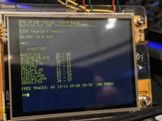

# CYD_VT100

A VT100/ANSI serial terminal for a 65C02 single-board computer, built on the ESP32-2432S028
"Cheap Yellow Display" (CYD). It connects to the SBC's TTL serial console, shows 53 × 30 characters
on the 2.8" screen, and takes keys from a USB keyboard through a CH9350 module, or from a Bluetooth
keyboard.



- VT100/ANSI display: cursor movement, clearing the screen and lines, inserting and deleting lines,
  scroll regions, colours, bold, underline and reverse video
- USB keyboard via a CH9350L module (one wire to the CYD), or a Bluetooth keyboard via Bluepad32
- UK or US keyboard layout, ANSI arrow and function keys, Ctrl codes, auto-repeat
- No extra hardware apart from the keyboard module and a resistor divider

To open it in the Arduino IDE, open `CYD_VT100.ino` (the folder name must stay `CYD_VT100`).

# Setup notes

## 1. Display library
Install **LovyanGFX** (by lovyan03) from the Library Manager. The display is set up inside the
sketch, so there's no `User_Setup.h` to edit. (TFT_eSPI isn't used: it hangs the ESP32 on the
Bluepad32 board package.)

If red and blue are swapped, set `cfg.rgb_order = true` in the sketch. If the colours look like a
negative, set `INVERT_COLOURS 1`.

## 1a. Keyboard
Pick the keyboard type with `KEYBOARD` at the top of the sketch.

**`KEYBOARD 2`, a USB keyboard through a CH9350 module (default).**
Use the normal **esp32** board package: **Tools → Board → esp32 → ESP32 Dev Module**.

| CH9350 module | CYD |
|---|---|
| 5V | 5V (the SBC's +5V, same as the CYD's VIN) |
| GND | GND |
| TX | **P3 GPIO35** (see the note below) |
| RX | not connected |

On the CYD's P3 connector, use only **GND** and **GPIO35**. P3's other two pins are GPIO22 (already
your SBC link) and GPIO21 (the backlight).

**Check the voltage on the module's TX pin before connecting it.** With the module powered and idle,
measure TX to GND. If it reads about 3.3V, connect it straight to GPIO35. If it reads about 5V, use the
same 1k/2k divider as for the SBC's TX.

The module must be in its standard settings: SEL high (keyboard side), and 115200 baud, which is the
default. Most modules come set up that way.

Plug in the keyboard and the screen shows "[USB keyboard ready]" at the first keypress. With
`KBD_DEBUG 1`, the Serial Monitor shows every message the module sends, which helps if a key doesn't work.

**`KEYBOARD 1`, a Bluetooth keyboard through Bluepad32.**
In **File → Preferences → Additional boards manager URLs**, add both of these:

```
https://raw.githubusercontent.com/espressif/arduino-esp32/gh-pages/package_esp32_index.json
https://raw.githubusercontent.com/ricardoquesada/esp32-arduino-lib-builder/master/bluepad32_files/package_esp32_bluepad32_index.json
```

Then select **esp32_bluepad32 → ESP32 Dev Module**. Put the keyboard in pairing mode after the CYD
starts; if it asks for a PIN, try 1234. To forget a paired keyboard, hold BOOT while you press RESET.
Bluepad32 doesn't work with every keyboard. The Advent K512, for example, pairs but is never recognised.

## 2. Wiring

| CYD | SBC TTL console header |
|---|---|
| P1 VIN | +5V |
| P1 GND | GND |
| CN1 GPIO27 (RX) | ACIA TX, through a divider: 1k in series, 2k to GND |
| CN1 GPIO22 (TX) | ACIA RX (no level shifting needed) |

Don't use the TX/RX pins on P1. They're shared with the USB serial chip.

## 3. Settings at the top of the sketch
- `SBC_BAUD` – match your ACIA
- `ROTATION` – 1 = landscape **53 × 30**, 0 = portrait **40 × 40**
- `LF_DOES_CR` – set to 1 if lines step down without returning to column 0
- `DEFAULT_FG` – 2 green, 3 amber/yellow, 7 white

## Keys sent to the SBC
Letters, numbers and symbols in UK layout (`UK_LAYOUT 0` for US). Enter = CR, Backspace = 08
(`KBD_BACKSPACE`), Delete = 7F, Esc, Tab, Ctrl+A–Z = 01–1A.
Arrows ESC[A/B/C/D, Home ESC[H, End ESC[F, PgUp ESC[5~, PgDn ESC[6~, Insert ESC[2~, F1–F4 ESC O P–S.
Caps Lock starts on (`CAPS_AT_START`). Held keys auto-repeat.

## Supported codes
CR LF BS TAB, ESC[ A B C D H f G d J K L M P @ X m r s u n c, ?25h/l (cursor),
?7h/l (autowrap), ESC 7 8 D E M c Z, SGR colours 30–37/40–47, bold, underline, reverse.
ESC[6n gets a cursor-position report back to the SBC.

## Licence
MIT. See [LICENSE](LICENSE).
